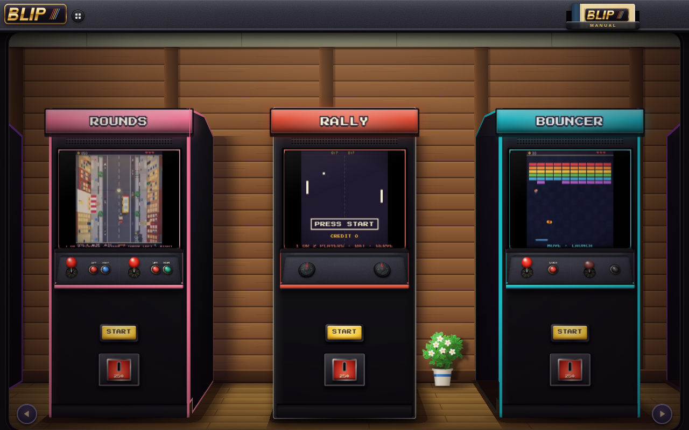
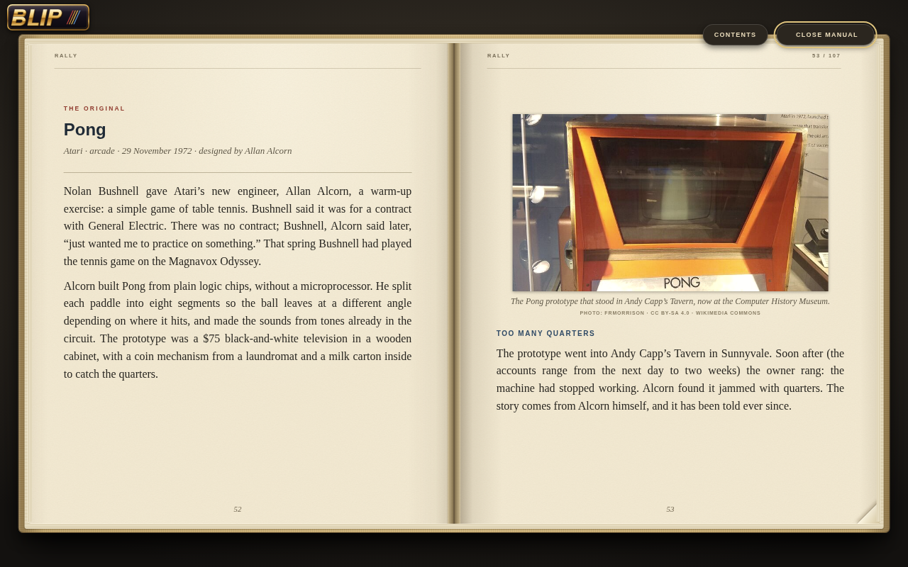

# Blip Arcade

Eleven arcade games in the browser, written in Rust on the small `blip` engine and compiled to WebAssembly.

**[Play →](https://jacobandresen.github.io/blip/)** · [Home Screen](https://jacobandresen.github.io/blip/home.html) · [API](https://jacobandresen.github.io/blip/api.html)

[](https://jacobandresen.github.io/blip/)

## Games

| Game | What it is |
|---|---|
| [Rally](https://jacobandresen.github.io/blip/rally/) | Table tennis, one or two players |
| [Serpent](https://jacobandresen.github.io/blip/serpent/) | A snake that grows through a maze |
| [Adder](https://jacobandresen.github.io/blip/adder/) | Vipers in a pit, up to six, two humans |
| [Bouncer](https://jacobandresen.github.io/blip/bouncer/) | Bricks, pickups and multi-ball |
| [Defender](https://jacobandresen.github.io/blip/defender/) | Alien formations and motherships |
| [Meteors](https://jacobandresen.github.io/blip/meteors/) | Thrust and shoot through asteroids |
| [Raider](https://jacobandresen.github.io/blip/raider/) | A vertical shooter with bosses |
| [Brawler](https://jacobandresen.github.io/blip/brawler/) | Seventeen fighters, a sixteen-match ladder |
| [Bubbler](https://jacobandresen.github.io/blip/bubbler/) | Trap monsters in bubbles, one or two players |
| [Warlock](https://jacobandresen.github.io/blip/warlock/) | A maze shooter in candlelit cellars |
| [Rounds](https://jacobandresen.github.io/blip/rounds/) | A paper round on a cargo bike, a week of weather |

The arcade is a room of cabinets: insert a coin and play. The Home Screen is the same games as phone apps, free to play. Best scores stay in your browser.

## The manual

Lift the manual from its holder on the top bar. It covers how to play each game, the history of the game it pays tribute to (the people, the studios and a few true stories, with sources and freely licensed photographs), and how to make a game of your own with Blip, by hand or with a coding agent.

[](https://jacobandresen.github.io/blip/history.html)

Its chapters are plain pages in `web/` (`controls.html`, `games.html`, `history.html`, `make.html`, `about.html`); the arcade sets them as a book and the Home Screen's Guide reads the same text.

## Build

```sh
cargo run --release -p rally              # play natively
rustup target add wasm32-unknown-unknown  # once
npm install                               # once, for the tests
npm run build:web                         # every game to web/<game>/
node tools/serve_web.mjs                  # serve web/ locally
```

[docs/blip.md](docs/blip.md) explains the engine; [AGENTS.md](AGENTS.md) covers layout, tests and conventions.

## Test

```sh
cargo test --release   # Rust rules and engine
npm test               # fast unit tests
```

The browser suites, the bots' playthroughs and the fun report are in [AGENTS.md](AGENTS.md#tests).

## Deploy

A push to `main` publishes `web/` to GitHub Pages. Each pull request gets a preview at `pr-preview/pr-<number>/`.

## Contributing

See [CONTRIBUTING.md](CONTRIBUTING.md).
