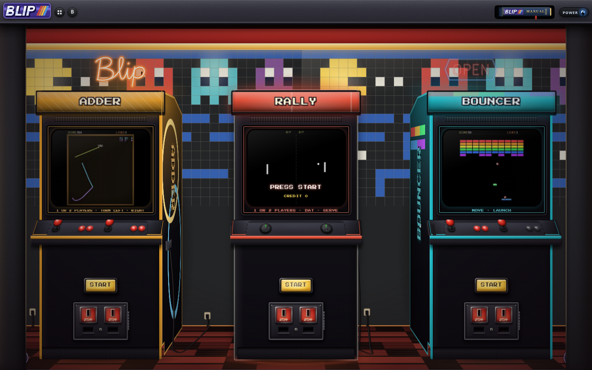

# Blip Arcade

Ten arcade games in the browser, written in Rust on the small `blip` engine and compiled to WebAssembly.

**[Play →](https://jacobandresen.github.io/blip/)** · [Home Screen](https://jacobandresen.github.io/blip/home.html) · [API](https://jacobandresen.github.io/blip/api.html)

[](https://jacobandresen.github.io/blip/)

## Games

| Game | What it is |
|---|---|
| [Rally](https://jacobandresen.github.io/blip/rally/) | Table tennis, one or two players |
| [Serpent](https://jacobandresen.github.io/blip/serpent/) | A snake that grows through a maze |
| [Adder](https://jacobandresen.github.io/blip/adder/) | Vipers in a pit, up to six, two humans |
| [Bouncer](https://jacobandresen.github.io/blip/bouncer/) | Bricks, pickups and multi-ball |
| [Defender](https://jacobandresen.github.io/blip/defender/) | Alien formations and motherships |
| [Meteors](https://jacobandresen.github.io/blip/meteors/) | Thrust and shoot through asteroids |
| [Raider](https://jacobandresen.github.io/blip/raider/) | A vertical shooter with bosses |
| [Brawler](https://jacobandresen.github.io/blip/brawler/) | Fifteen fighters, a fourteen-match ladder |
| [Bubbler](https://jacobandresen.github.io/blip/bubbler/) | Trap monsters in bubbles, one or two players |
| [Warlock](https://jacobandresen.github.io/blip/warlock/) | A maze shooter in candlelit cellars |

The arcade is a room of cabinets: insert a coin and play. The Home Screen is the same games as phone apps, free to play. Best scores stay in your browser.

## Build

```sh
cargo run --release -p rally              # play natively
rustup target add wasm32-unknown-unknown  # once
npm install                               # once, for the tests
npm run build:web                         # every game to web/<game>/
node tools/serve_web.mjs                  # serve web/ locally
```

[docs/blip.md](docs/blip.md) explains the engine; [AGENTS.md](AGENTS.md) covers layout, tests and conventions.

## Test

```sh
cargo test --release      # Rust rules and engine
npm test                  # fast unit tests
npm run test:web          # browser suites (headless Chromium and WebKit)
npm run test:visual       # every game starts and responds to input
npm run test:playthrough  # the playtest bots play every game
```

## Deploy

A push to `main` publishes `web/` to GitHub Pages. Each pull request gets a preview at `pr-preview/pr-<number>/`.

## Contributing

See [CONTRIBUTING.md](CONTRIBUTING.md).
