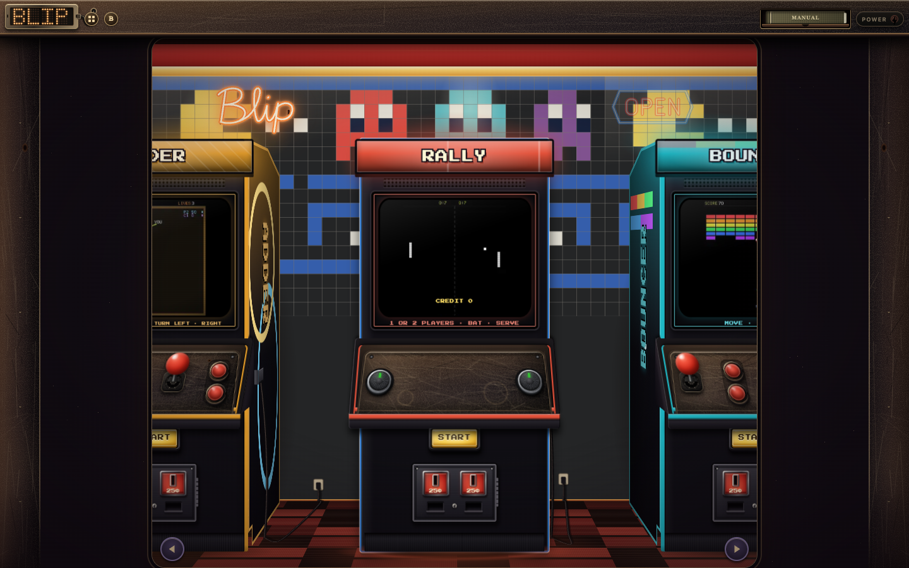
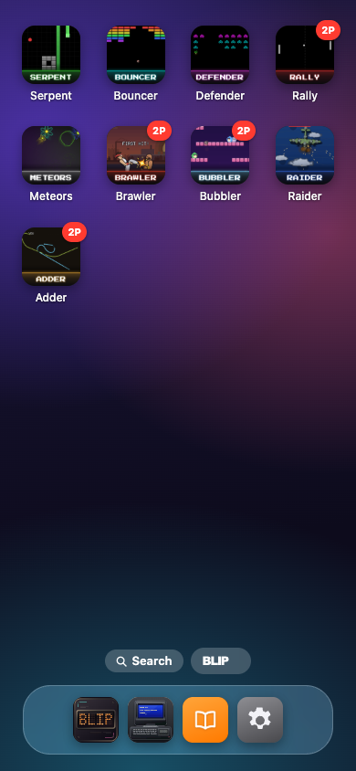

# Blip Engine Arcade

Step inside, pick a machine, and chase that next high score! Blip packs nine arcade games, a fresh iOS-style Home Screen, and a programmable retro computer into your browser. The games run on the Rust `blip` engine, compiled to WebAssembly.

**[Play in the browser →](https://jacobandresen.github.io/blip/)**

[](https://jacobandresen.github.io/blip/)

*The current arcade front, captured from the local build on 26 October 2026. Pick a cabinet and let the buttons do the talking.*

**[Explore the Blip API →](https://jacobandresen.github.io/blip/api.html)** — see how the games use the engine, then try making one with Rust or an AI coding agent such as Claude Code or Codex.

## Games

- **[Rally](https://jacobandresen.github.io/blip/rally/)** — table tennis for one or two players. Keep your eye on the ball!
- **[Serpent](https://jacobandresen.github.io/blip/serpent/)** — guide a growing snake through a maze and keep your tail out of trouble.
- **[Adder](https://jacobandresen.github.io/blip/adder/)** — weave through a pit of rival vipers, slip through gaps in their bodies, and bring a second player along.
- **[Bouncer](https://jacobandresen.github.io/blip/bouncer/)** — smash bricks, grab pickups, and unleash multi-ball mayhem.
- **[Defender](https://jacobandresen.github.io/blip/defender/)** — take on alien formations and their motherships. They brought friends.
- **[Meteors](https://jacobandresen.github.io/blip/meteors/)** — thrust, turn, and blast through drifting asteroids.
- **[Raider](https://jacobandresen.github.io/blip/raider/)** — fly into formations, flak, and bosses in a vertical shooter.
- **[Brawler](https://jacobandresen.github.io/blip/brawler/)** — choose from 15 fighters and climb a 14-match ladder, in Rust or BLIP BASIC.
- **[Bubbler](https://jacobandresen.github.io/blip/bubbler/)** — bubble-blowing platform action for one or two players. Trap trouble, then pop it!

## A little arcade in your pocket

The new **[iOS-style Home Screen](https://jacobandresen.github.io/blip/home.html)** puts every game behind a colorful app icon, with a dock, search, and long-press menus. Rearrange your favorites, tap straight into free play, or add a game to your device's Home Screen for a quick rematch. The dock takes you back to the cabinet aisle whenever the neon calls.

<a href="https://jacobandresen.github.io/blip/home.html"></a>

## Meet BLIP BASIC

Fancy making the machine do your bidding? **[BLIP BASIC](https://jacobandresen.github.io/blip/basic.html)** is an Amiga-inspired BASIC playground inside a retro computer, complete with game cassettes, a console, and an editor. Load a numbered game tape, peek at its code, change the rules, and run it again. Brawler even brings its full 15-fighter ladder to BASIC.

The interpreter runs in Rust and shares drawing, math, and effects with the Blip engine. Start with the **[BLIP BASIC programming book](https://jacobandresen.github.io/blip/basic-book.html)**, then dig into the [language and engine guide](crates/blip_basic/README.md). Your next arcade obsession could be one you write yourself.

---

## 🚀 Getting Started

### Native development

Install Rust and Cargo, then build or run a game:

```bash
cargo build --release
cargo run -p rally
```

See the [Blip API page](https://jacobandresen.github.io/blip/api.html) or [source guide](docs/blip.md).

### Web build

```bash
rustup target add wasm32-unknown-unknown
cargo build-web
node tools/serve_web.mjs
```

The build places each game's `index.wasm` in `web/<game>/`; the shared shell and macroquad runtime are served from `web/`.

### Deployment and previews

GitHub Pages serves the `gh-pages` branch. A push to `main` applies new database migrations, then publishes `web/` to the branch's root ([pages.yml](.github/workflows/pages.yml)); the site is at <https://jacobandresen.github.io/blip/>.

Each pull request from a branch of this repository gets a preview at `https://jacobandresen.github.io/blip/pr-preview/pr-<number>/`, linked in a comment on the pull request and removed when it closes ([preview.yml](.github/workflows/preview.yml)). Only the five most recently updated open pull requests keep a preview, and `gh-pages` is squashed to one commit after every deploy ([preview-cleanup.yml](.github/workflows/preview-cleanup.yml)); push to a pull request to bring its preview back. Previews have no high scores and no offline cache, and share saved settings (coins, sound, home-screen order) with the live site. Pull requests from forks get no preview.

### Kiosk controls

Use the stick or arrows to select a game and fire to start. Fire, Enter or `5` inserts a coin; Backspace returns to the cabinet; `M` toggles sound. The fullscreen choice persists across pages, and idle games return to the cabinet.

See [CONTRIBUTING.md](CONTRIBUTING.md) before submitting changes.
