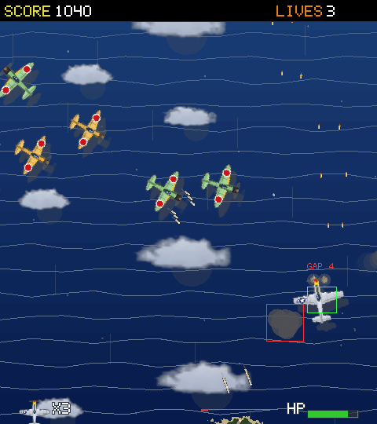
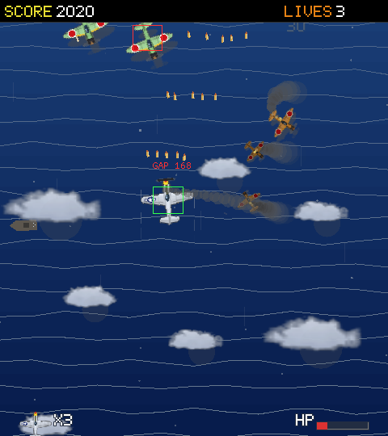
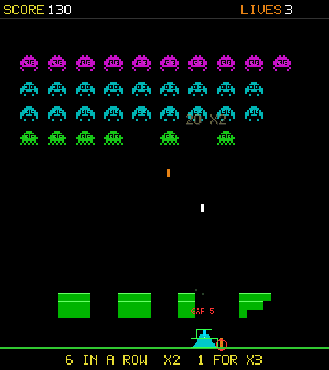
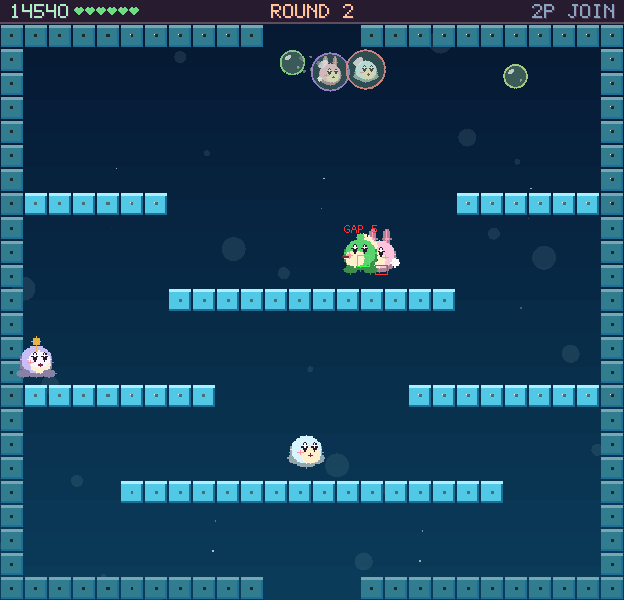

# How much fun is a game? Three measures for blip

blip's games are played by bots in tests already. This report asks what those bots can tell us about how much fun
a game is, picks three measures from the research on player enjoyment, builds them into `blip::bot` (`fun.rs`,
beside this file) and `tools/fun_report.mjs`, uses them on every game, and turns them into a CI check that fails a
pull request which makes a game less fun.

**In short.** The research agrees on three things a bot can measure. Ranked: **skill pays** (good play beats random
play), **close calls** (dangers come near and can be dodged) and **busy** (little time with nothing to do). Each
game gets a fun score from 0 to 100 from them. CI plays every changed game before and after a pull request and fails
it when the score, or the raw signal under any measure, gets significantly worse. On its first use the near-miss
meter found Raider charging the player for **phantom hits** from bullets on the far side of the screen: fixing it
cut hits from 8.5 to 2.8 a minute and lives lost from 0.33 to 0 per run, on the same six seeds, and the gate
blocks a pull request that brings the bug back. What raised the measures most since: rewarding skill (a no-damage
streak in Raider, skill 0.14 → 0.27; an accuracy streak in Meteors; Defender's streak broken by a lost cannon) and
removing unfair hits (point-blank flak, fireballs that burned from a cell away). Continues let players reach the later
levels of the five games with authored ones. Tuning opponents and rewarding grazes did not help, and stayed out; every
attempt is in [FUN-LOG.md](FUN-LOG.md). The work also moved path finding, swept hit tests, streaks and continues into
`blip`, and made every bot run about 2.4 times faster.

| A near miss, hit boxes drawn | The phantom hit (before the fix) |
|---|---|
|  |  |
| A flak burst's box (red) ends 4 px from the plane's (green). | The plane loses health while the nearest hazard is 168 px away. |

## 1. What the research says

No study measures fun directly; each names what enjoyment is made of and how to observe it. The frameworks that
matter here, and which of their parts a bot can see:

| Source | What enjoyment is made of | What a bot can measure |
|---|---|---|
| Malone 1980, *What makes things fun to learn* | challenge, fantasy, curiosity | challenge |
| Csikszentmihalyi 1990, *Flow* | a challenge matched to skill, clear goals, feedback, concentration | challenge, concentration |
| Sweetser & Wyeth 2005, *GameFlow* | concentration, challenge, player skills, control, clear goals, feedback, immersion, social | challenge, concentration, skill |
| Ryan, Rigby & Przybylski 2006, SDT / PENS | competence, autonomy, relatedness (need satisfaction) | competence (effort turns into success) |
| Yannakakis & Hallam 2007 | appropriate challenge, opponent behaviour diversity, spatial diversity (predator/prey games), validated against player rankings | challenge |
| IJsselsteijn, de Kort & Poels (GEQ) | immersion, flow, competence, positive and negative affect, tension, challenge | competence, tension |
| Browne & Maire 2010, *Ludi* | 57 measurable traits of board games; a subset (uncertainty, drama, lead change, ...) predicted human rankings | uncertainty, drama |
| Nielsen, Barros, Togelius & Nelson 2015; Liu et al. 2017 | skill depth: better players (stronger AI agents) get better results; good games separate them more | the gap between a strong and a weak player |
| Lantz, Isaksen, Jaffe, Nealen & Togelius 2017 | strategic depth: a ladder of ever better strategies | the gap between players |
| Isaksen, Gopstein, Togelius & Nealen 2015, 2018 | difficulty as survival: the hazard rate of a player model with human motor skills | deaths over time |
| Reid 1986; Clark et al. 2009 | near misses raise the urge to keep playing, *only when the player controls the outcome* | near misses |
| Juul 2013, *The Art of Failure* | failure is enjoyable when the player can blame themselves and improve, not the game | fair versus unfair hits |
| Hunicke 2005; Booth 2009 (Left 4 Dead's AI director) | keep challenge in a band; pace intensity in build-up, peak, relax | intensity over time |
| Roohi et al. 2021 | AI players predict human pass rate (difficulty) and churn (engagement); an agent's *best* runs predict best | difficulty |

Three things recur. **Competence and skill**: every framework has it, the SDT work names it a basic need, and the
depth papers make it measurable by playing a strong and a weak agent and comparing results. **Challenge** that is
neither trivial nor unfair: flow, GameFlow, Yannakakis and Hallam, Isaksen's hazard rates and the near-miss studies
all measure it from different sides. **Concentration**: GameFlow's first element; boredom is what Roohi et al.'s
player model leaves for. Other parts are real but either need people (immersion, autonomy, social) or suit only some
games (drama needs an opponent, diversity a predator/prey game).

The validation record is uneven, and says to keep the measures few and concrete: Law, Brühlmann & Mekler (2018)
found no support for the GEQ's seven factors; Johnson, Gardner & Perry (2018) found PENS competence and intuitive
controls to be one factor, not two. Constructs that are measured from play (score gaps, hazard rates, near misses)
are on firmer ground than questionnaire scales, which is where a bot can contribute.

## 2. The three measures, by importance

### 1. Skill pays (weight 3)

*Does playing well beat playing randomly?* Competence is the best-supported construct above, and the skill-depth
papers give the method: the score of a capable player against a weak one. A game where random play scores as well
as good play is decided by luck, and nothing the player learns matters.

- **Approach A (chosen): bot against random input.** Each seed plays the bot and `BLIP_BOT_FUZZ` (random keys
  held a few frames). `skill = log10(bot score / random score) / 2`, clamped to 0..1:
  100 times random play's score or more is 1. Random play is a baseline, not a pair, so its score is averaged over
  all seeds; fewer random runs were tried and moved Brawler's skill from 0.45 to 1 when none of three happened to
  score. No game code.
- **Approach B: a ladder of bots.** Weaken the bot step by step (reaction delay, look-ahead, aim error) and fit how
  fast the score falls, as in RAPP. Closer to the papers, but needs a knob per game, and a reaction-delay version
  tried here (`BLIP_BOT_LAG`, every control 12 frames late) was noisier than the gap it measured on two seeds.

References in the games: Serpent's bot scores about 100 times random play; Bubbler's barely more (random play bursts
bubbles too); Defender's random cannon still hits a marching formation. Brawler and Adder score 0 at random.

### 2. Close calls (weight 2)

*Do dangers come close, and can they be dodged?* This is challenge seen from the player's hit box: Isaksen's hazard
rates count the hits, the near-miss studies the misses, and Juul and blip's own rule ("every hazard has a tell and can
be avoided") the fairness of the hits.

- **Approach A (chosen): hit boxes, edge to edge.** The game's bot passes, every frame, the player's hit boxes and the
  hazards' boxes *as the game's collision code tests them* (`blip::bot::near`). A hazard within 16 px starts a
  *pass*; the pass ends as a **near miss** when the boxes part, or as a **hit** when they touch or the game reports a
  hit (a rise in `deaths` or a `hit_*` stat; games remove a bullet the frame it hits and test hits on swept paths,
  so touching boxes alone miss hits; a life lost within 3 s of a hit is that hit). `close = near misses / (near
  misses + hits)`. With `BLIP_BOT_NEAR=<dir>`, each
  pass's closest frame is saved with the boxes drawn: green the player, red the nearest hazard (a point hazard gets a
  ring), yellow others near, and the gap in pixels.
- **Approach B: centre distance.** Distance between centres under a radius. Simpler, but wrong for long or wide
  shapes (a plane's wing tip is far from its centre) and blind to how the game really tests hits.

The boxes, from each game's collision code:

| Game | Player | Hazards |
|---|---|---|
| Raider (`main.rs`, player vs hazards) | the plane's 38 x 34 hit box at 47 % of the sprite's height | rounds (points against the box grown by 2 px), flak shells, flak bursts (circles of 24 px, here their bounding box), planes (their middle 60 %), the boss (its middle 60 x 70 %) |
| Defender (`bomb_hits_ship`) | the cannon's wedge as two stacked boxes, each as wide as the wedge at its lower edge, plus 2 px | bombs (their tip, a point) |
| Bubbler (`hurt_players`) | the dragon shrunk by `CONTACT_INSET` (3.5 px a side, 5 px top and bottom) | monsters (shrunk the same), thrown rocks (points against the dragon grown by `SHOT_REACH`) |
| Meteors | the ship's circle (`SHIP_RADIUS`), as its bounding box | rocks and saucers (`saucer_radius`), as their bounding boxes; saucer shots (points) |
| Warlock (`check_contact`) | the wizard where drawn, `TOUCH_R` across | monsters and fireballs where drawn, the same |
| Rounds | the bike, less half of `CRASH_INSET` | every solid hazard, less the same |

Each game names its hit box once (`plane_hit_box`, `CONTACT_INSET`, `TOUCH_R`, ...) and both its collision code and its
bot's hook use it, so the measure cannot drift from the game. Serpent, Adder, Bouncer, Rally and Brawler have no
hazards of that kind (or, in Brawler, hit boxes that are moves) and leave this measure out.

### 3. Busy (weight 1)

*How much of the time is there something to do?* GameFlow's concentration element; the cost of idle stretches is
plain in an arcade cabinet, where a bored player walks away.

- **Approach A (chosen): from the controls.** `busy = 1 - fun_dead`, where `fun_dead` is the share of the run spent in
  stretches of more than 2 s with the controls untouched (cards, intros, waits, respawns). No game code.
- **Approach B: from the bot's choices.** Where a bot scores options (`utility::choose`, `rollout::best`), count the
  close calls between the best and second-best: real decisions. Only some bots score options.

References: the `IDLE` lines `BLIP_BOT_NEAR` prints put Raider's 7.6 s carrier take-off, Brawler's 5 s round
intros, Adder's round changes and Serpent's long straight runs on the record.

### Measures tried and dropped

The first version measured seven things. Four were cut: **decisions a minute** was 1.0 (saturated) in every game, so
it separated nothing; **variety** (entropy of control combinations) measured the bot's habits more than the game;
**difficulty spikes** (deadliest level over the run's death rate) never had enough deaths per level in a run to
compute; **drama** (lead changes and close time, after Browne) needs a contest and was 0 to 0.6 by luck of the seed.
**Warning time** before a hit mostly measured how fast a hazard closes the last 16 px. Each is a reasonable idea with
more data; none earned a place among three.

### Comparing the approaches

Each approach scored 1 (poor) to 3 (good): **general** (every game, no new game code), **valid** (tracks what the
research says players feel), **cheap**, **stable** (repeats across seeds), **actionable** (points at what to change).

| Measure | Approach | General | Valid | Cheap | Stable | Actionable | Total |
|---|---|---|---|---|---|---|---|
| skill | **A bot vs random** | 3 | 3 | 3 | 2 | 2 | **13** |
| | B bot ladder | 1 | 3 | 1 | 1 | 2 | 8 |
| close calls | **A hit boxes** | 2 | 3 | 2 | 2 | 3 | **12** |
| | B centres | 2 | 1 | 3 | 2 | 1 | 9 |
| busy | **A controls** | 3 | 2 | 3 | 3 | 3 | **14** |
| | B option spread | 1 | 2 | 2 | 2 | 1 | 8 |

## 3. The score and the gate

`fun = 100 x (3 skill + 2 close + 1 busy) / (sum of the weights present)`, per seed; a game's fun is the mean over
its seeds. A measure a game cannot take is left out, so a game is compared with itself over time, not with other
games.

**Noise.** A bot run repeats exactly for a seed, but any change to a game or its bot sends the run down another path,
so a fair check must expect seed-to-seed variation. Six seeds of 60 s on the same code give each game a spread (the
± column below): 1.5 to 3 points for most games, 6 for Bouncer and Brawler, 10 to 14 for Raider and Bubbler and 25
for Warlock, where one seed in six loses the wizard early. Two seed sets of the same code differed by up to 30 points
on two seeds each, which is why the gate pairs seeds and tests significance instead of comparing two numbers.

**The gate.** `tools/fun_report.mjs --against base.json` compares seed by seed (base and head play the same seeds)
and fails a game when any of these gets worse by more than its limit *and* by more than twice the change's standard
error, so a real loss stands out from chance. Each pair is scored on the measures both sides take, so a game that
gains a hit-box hook is not marked down for a measure its base could not take:

| Check | Fails when |
|---|---|
| the fun score | it falls by more than 5 points |
| skill's raw signal, the bot's score | it falls by more than 10 % |
| close calls' raw signal, hits a minute | it rises by more than 1 |
| busy's raw signal, dead time | it rises by more than 5 % of the run |

The raw signals are checked as well as the score because a weighted score dilutes them, as the Raider case below
shows. `.github/workflows/fun.yml` runs it on every pull request that touches the games, the shared
crate or the tool, for the games whose code changed (`fun_report.mjs --changed <base>`: a game's own crate, or every
game when shared code changed; a pull request that changes no game measures nothing and passes): one job per game,
side by side, each building the base (in a worktree) and the head, playing 6 seeds
of 60 s on both, and uploading both reports and the near-miss frames. A last job, `fun`, passes only if every game
passed; it is the check to require in the branch protection rule. Measuring base and head on the same runner leaves no
stored baseline to go stale or edit. A change meant to alter a game's feel that loses points says why in its
description and is merged by an admin past the check.

**Does it work?** Three tests, on runs saved by the tool (`--from` scores saved runs again without playing):

| Pull request | Fun score | Gate |
|---|---|---|
| brings Raider's phantom hits back | -3.6 ± 4.0 | **fails**: hits +5.67 ± 1.31 a minute, score -13 % (log -0.06 ± 0.02) |
| fixes them | +3.6 ± 4.0 | passes |
| a neutral bot tweak in Bouncer (steering slack 5 to 5.5 px) | +1.2 ± 2.9 | passes |
| a neutral bot tweak in Warlock (fetches potions one tile further) | +6.1 ± 0.7 | passes |

The first row is why the raw checks exist: on the score alone the bug would have merged.

## 4. What the measures found, and what changed

**Raider charged the player for hits from across the screen.** Its swept hit test drew a line from where each enemy
round was when the frame began to where it is now. Rounds fired during the frame land in free slots, and a free
slot's "start" was where its previous round had stopped: often right on the plane, where it last hit. So a new round
fired from the top of the screen swept a line through the plane and hit it. The near-miss meter found it: the game
reported hits while no hazard was within 160 px (the frame above). The fix sweeps a new round from where it is. On
the same six seeds:

| Raider, 6 seeds of 60 s | With the bug | Fixed |
|---|---|---|
| hits a minute | 8.5 | **2.8** |
| near misses a minute | 8.0 | 3.3 |
| close calls (near / passes) | 0.48 | **0.65** |
| lives lost per run | 0.33 | **0** |
| bot's score | 4520 | **5207** |
| fun | 37.8 | **41.3** |

**Warlock's monsters slid to their target in one step.** Its path finder returned the target tile with the first
direction, not the first step's tile, so a hunting or lunging monster glided across the room to the wizard in one
move. Path finding is now shared (`blip::grid`) and monsters walk one tile at a time; all seven Warlock
playthroughs pass.

**Later changes, each measured** (all in [FUN-LOG.md](FUN-LOG.md), with what was tried and dropped):

| Game | Change | Measured |
|---|---|---|
| Raider | Flak guns hold fire inside 110 px (a shell's 0.46 s flight leaves time to dodge) | hits 2.8 → 1.2 a minute, near misses 3.3 → 4.3, fun +5.8 ± 2.1 |
| Raider | Holding fire hurries the take-off, which plays before every level | busy 0.80 → 0.90 |
| Raider | A no-damage streak: every five kills without a hit raise the score multiple, up to x4 | skill 0.14 → 0.27, fun +6.4 ± 0.5: the bot's score doubles, random play's barely moves |
| Meteors | An accuracy streak: every five hits without a wasted shot raise the multiple, up to x4 | bot +3 to +19 %, random play unchanged; fun +1.6 ± 0.4 |
| Warlock | Fireballs burn by drawn position, like monsters (they hit from a cell away) | a fairness fix; no measurable change |
| Warlock | The bot steps away from a monster beside it, as a player would | close calls 0.08 → 0.51: a game of near escapes, now seen |
| Bubbler, Raider, Warlock, Rounds, Bouncer | A continue at game over (shared `blip::Continue`): the same room, level, chamber, day or bricks, fresh lives, the run's best reported | playthroughs and unit tests; time after a game over, so outside the three measures. Not in the score-attack games, whose originals end a run there |

What did not work is as useful: grazing in Raider (random play grazes by blundering, so skill fell), monsters
pausing to "say hello" in Bubbler (a slow player died sooner), evening out Brawler's fighters with the difficulty
dial (its difficulty is in matchups, and Giotto's weakness is his moves), and a CPU sight ramp in Adder (no change in
rounds won).

**Shared building blocks the bots exposed.** Writing the bots' hit boxes meant reading every game's collision code,
and it showed the same three steps written five times (Raider, Defender, Bubbler, Rally, Meteors): record where each
thing was when the frame began, give a thing spawned mid-frame no start, and test a moving point against a moving box
in the box's frame. Raider got the second step wrong. `blip` now has them once: `frame_starts` (a start only for
things live at the frame's start), `swept_from` and `sweep_hits`. Raider, Defender and Bubbler use them; every game's
run is identical before and after. Defender's and Serpent's score streaks became one `blip::Streak`, which Meteors'
and Raider's new streaks use too. Earlier in this work the bots' look-ahead and the games' own physics were found to
share speed-with-mass (`blip::spool`), path finding (`blip::grid`) and choosing the cheapest option
(`bot::best`), now shared too.

**Faster runs.** Under Xvfb the games render in software, and drawing was most of a bot run's time. A bot run now
draws one frame in 30 (`BLIP_BOT_DRAW`, 1 draws all): every game still runs all its drawing code, so its random
numbers are drawn the same way, but onto a one-pixel viewport, and the frame is not shown. Brawler's 30 s ran in 11 s
instead of 27, and all eleven games give the same `RESULT` line as with every frame drawn. Runs that save frames draw
them all. Measuring all eleven games (six seeds, the bot and random play) took 20 minutes instead of 44, and gave every game exactly the same scores, seed for seed.

## 5. Every game now

Six seeds of 60 s each, in the arcade's order, with every change in [FUN-LOG.md](FUN-LOG.md) applied. **This is not a ranking.** The score compares a game with itself over
time, which is all the CI gate does. Across games it mostly reflects which measures a game can take (only Raider,
Defender and Bubbler report hit boxes) and what kind of game it is. A calm, simple game scores low on measures made
for tension and still delights: Rally is the lowest here and one of the most loved, because it is simple and it
recalls simpler days. Nostalgia, calm and familiarity are part of fun (Malone's *fantasy*; Juul on why people
choose easy and casual games) that no bot can see.

| Game | Fun | ± | Per seed | Skill | Close calls | Busy | Hits a minute |
|---|---|---|---|---|---|---|---|
| serpent | **92.8** | 1.6 | 91, 93, 91, 95, 94, 93 | 1 |  | 0.71 |  |
| bouncer | **88.4** | 6.2 | 82, 97, 84, 92, 91, 84 | 0.85 |  | 0.99 |  |
| defender | **65.8** | 3 | 64, 68, 70, 67, 63, 63 | 0.32 | 1 | 1 | 0.0 |
| rally | **40.5** | 2.1 | 41, 42, 42, 40, 37, 41 | 0.23 |  | 0.94 |  |
| meteors | **64.6** | 8.4 | 48, 66, 70, 68, 68, 68 | 0.58 | 0 | 1 | 0.2 |
| brawler | **52.5** | 6.4 | 59, 56, 46, 44, 56, 54 | 0.45 |  | 0.74 |  |
| bubbler | **48** | 13.6 | 63, 38, 53, 47, 27, 60 | 0.17 | 0.72 | 0.94 | 0.7 |
| raider | **50.1** | 13.6 | 27, 57, 48, 44, 66, 59 | 0.27 | 0.65 | 0.9 | 1.7 |
| adder | **89.9** | 1.5 | 90, 90, 89, 88, 91, 92 | 1 |  | 0.6 |  |
| warlock | **70** | 17 | 90, 76, 64, 46, 57, 86 | 0.74 | 0.51 | 0.97 | 4.9 |
| rounds | **82.5** | 1.1 | 83, 81, 82, 83, 82, 84 | 0.69 | 1 | 0.88 | 0.0 |

What the table points at:
- **Rally's skill is low because of how it scores**, not its play: 60 s of Rally is two or three points, and random
  play scores none, so the ratio is small. A longer run or a per-rally score would measure it better.
- **Bubbler's random play scores almost as well as the bot** (skill 0.17): a dragon mashing keys blows bubbles that
  catch monsters anyway. For a game made for young children that may be right; it is still worth a look.
- **Defender: no hits at all** in six minutes, and close calls of 1: the cannon dodges everything. Its fun comes from
  skill and the near misses, and a harder bomb pattern would show up here first.
- **Adder and Serpent are the least busy** (0.6 and 0.71): Adder's round changes and long straight runs, Serpent's long
  straight stretches between turns. The `IDLE` lines say where.
- **Warlock's close calls were 0.08**: monsters reached the bot more often than they passed it, because it walked at
  them to bolt them. A bot that steps away from a monster beside it (as a player does) sees 7 near misses a minute
  and close calls of 0.51: Warlock is a game of near escapes.

| Defender near miss | Bubbler near miss |
|---|---|
|  |  |
| A bomb's tip (ringed, red) passes 5 px from the cannon's wedge, drawn as two boxes. | A monster's contact box 5 px from the dragon's: the boxes are smaller than the sprites, so bodies can overlap without a hit. |

## 6. Limits and next steps

- Fun is more than these three measures. Calm, simplicity and nostalgia matter and are not measured; a low score is
  never a reason to change a game, only a falling one is a reason to look.
- A bot is not a person. The measures say where a person is likely to be bored or cheated; the frames and `IDLE` lines
  say where to look. Roohi et al. found an agent's best runs track people better than its average, worth trying.
- Close calls cover the six games with hazards. Brawler's hit boxes are its moves; a hook there would measure
  blocks and whiffs, a different question.
- Six seeds of 60 s take a few minutes a game; more seeds narrow the noise and catch smaller losses.
- The skill measure's logarithm squashes moderate score changes (a 13 % loss is 0.03); the gate's score check covers it.
- The weights (3, 2, 1) follow the ranking, not a fit to player data; a playtest with people rating games would set them.

## References

- Booth, M. (2009). *The AI Systems of Left 4 Dead.* Invited talk, AIIDE 2009, Stanford.
- Browne, C., & Maire, F. (2010). Evolutionary game design. *IEEE Transactions on Computational Intelligence and AI in Games*, 2(1).
- Clark, L., Lawrence, A. J., Astley-Jones, F., & Gray, N. (2009). Gambling near-misses enhance motivation to gamble and recruit win-related brain circuitry. *Neuron*, 61, 481–490.
- Csikszentmihalyi, M. (1990). *Flow: The Psychology of Optimal Experience.* Harper & Row.
- Hunicke, R. (2005). The case for dynamic difficulty adjustment in games. *ACE 2005*, 429–433.
- IJsselsteijn, W. A., de Kort, Y. A. W., & Poels, K. *The Game Experience Questionnaire.* Technische Universiteit Eindhoven.
- Isaksen, A., Gopstein, D., & Nealen, A. (2015). Exploring game space using survival analysis. *FDG 2015*.
- Isaksen, A., Gopstein, D., Togelius, J., & Nealen, A. (2018). Exploring game space of minimal action games via parameter tuning and survival analysis. *IEEE TCIAIG*, 10(2), 182–194.
- Johnson, D., Gardner, M. J., & Perry, R. (2018). Validation of two game experience scales: PENS and GEQ. *International Journal of Human-Computer Studies*, 118.
- Juul, J. (2013). *The Art of Failure: An Essay on the Pain of Playing Video Games.* MIT Press.
- Lantz, F., Isaksen, A., Jaffe, A., Nealen, A., & Togelius, J. (2017). Depth in strategic games. *AAAI Workshop on What's Next for AI in Games*.
- Law, E. L.-C., Brühlmann, F., & Mekler, E. D. (2018). Systematic review and validation of the Game Experience Questionnaire (GEQ). *CHI PLAY 2018*, 257–270.
- Liu, J., Togelius, J., Pérez-Liébana, D., & Lucas, S. M. (2017). Evolving game skill-depth using general video game AI agents. *IEEE CEC 2017*.
- Malone, T. W. (1980). What makes things fun to learn? A study of intrinsically motivating computer games. Xerox PARC.
- Nielsen, T. S., Barros, G. A. B., Togelius, J., & Nelson, M. J. (2015). General video game evaluation using relative algorithm performance profiles. *EvoApplications*, LNCS 9028, 369–380.
- Reid, R. L. (1986). The psychology of the near miss. *Journal of Gambling Behavior*, 2, 32–39.
- Roohi, S., Guckelsberger, C., Relas, A., Heiskanen, H., Takatalo, J., & Hämäläinen, P. (2021). Predicting game difficulty and engagement using AI players. *Proc. ACM HCI* 5 (CHI PLAY), 231.
- Ryan, R. M., Rigby, C. S., & Przybylski, A. (2006). The motivational pull of video games: A self-determination theory approach. *Motivation and Emotion*, 30, 344–360.
- Sweetser, P., & Wyeth, P. (2005). GameFlow: A model for evaluating player enjoyment in games. *Computers in Entertainment*, 3(3).
- Yannakakis, G. N., & Hallam, J. (2007). Towards optimizing entertainment in computer games. *Applied Artificial Intelligence*, 21(10), 933–971.
